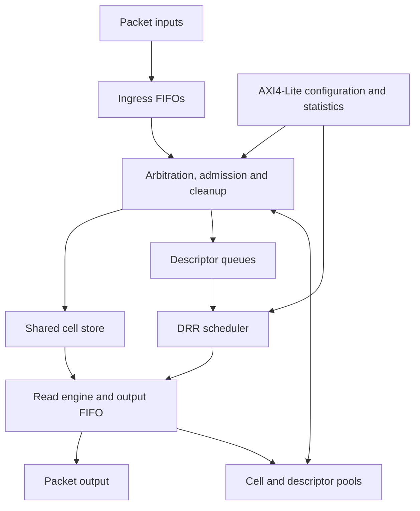

# Shared-Buffer Packet Traffic Manager

A single-clock SystemVerilog traffic-manager slice for variable-length packets:
four independently backpressured 64-bit inputs share sixteen logical queues,
64 KiB of payload cells and 256 packet descriptors, with one packet output.
The design combines whole-packet reservation, store-and-forward publication,
byte-based deficit round robin and an AXI4-Lite control/statistics plane.

## Data path



This is the target architecture. FIFOs, bitmap pools, CSR/statistics and the UVM
foundation are implemented and locally verified. Queue, scheduler, memory/TX,
receive/admission and production top integration are the remaining hardware work.
Declaration elaboration and bench fixtures do not establish an integrated TM.
[Current status](docs/status.md) and the [implementation plan](docs/implementation/plan.md)
identify the exact completed scope and next prerequisites.

## Engineering decisions

| Decision | Consequence |
| --- | --- |
| Reserve the declared packet's cells and one descriptor before service | Admission cannot overbook shared capacity; DROP/WAIT and malformed cleanup are explicit |
| Publish at successful commit; dequeue at dispatch | Per-queue order follows commit, including cross-input completion races |
| One payload read and one write per cycle | Four inputs share ingress bandwidth; read credits track fixed one/two-cycle responses |
| DRR accounts in bytes, packet RR is the comparison mode | Mixed packet sizes exercise fairness beyond equal packet counts |
| Reset flushes in-flight work | No stale responses or packets may appear in the next epoch |
| ANSI records/types through the selected Slang frontend | Shared fixed/dependent types preserve explicit layouts and supported configurations |

The default profile is F0; F1 tests read latency two. I0/I1 are small fully mapped
implementation profiles, and E0/E1 exercise configuration boundaries. The
[architecture](docs/spec/architecture.md) defines the six profiles, targets and
exclusions. The project does not claim Ethernet wire rate, physical signoff or
silicon power measurement. New mapped timing uses the identified public reference
library and explicitly scoped reset/IO assumptions.

## Build and verification

Use the qualified Linux x86-64 cloud toolchain and repository setup recipe:

```sh
make setup
make doctor
make regression RUN_ARGS='--profile E0 --test pools --seed 17'
make regression RUN_ARGS='--profile I0 --test uvm-foundation --seed 23'
make regression RUN_ARGS='--profile E0 --test csr --seed 17'
make formal-rtl RUN_ARGS='--timeout 240'
```

Setup installs pinned dependencies; ordinary tests use that installation.
`make repo-check` validates repository contracts only. `make ci` includes
capability fixtures and registered component checks; its actual cases and scopes
come from the runner. Future production suites are added by their owning tasks.

The exercised stack uses Yosys 0.70+post/Slang, Verilator 5.054, official UVM
2020.3.2, SBY 0.71, Z3 5.4.1 and OpenSTA 3.2.0. Exact source/transitive identities,
ABI requirements and activation commands are in the
[locks](tools/dependencies.json) and [toolchain guide](docs/implementation/toolchain.md).

SV/UVM drivers, passive monitors, RAL, independently batched policy/resource
models, constrained packet generation, SVA and selected production formal proofs
are exercised at their recorded component/fixture scope. The black-box scoreboard
uses monitored handshakes, not driver intentions. Four-state simulation remains
outside the qualified two-state flow. New fixed formal witnesses require
[F01](docs/implementation/tasks/F01-formal-symbols.md) before queue proof work.

## Results and navigation

- [Normative specifications](docs/spec/README.md) and [module contracts](docs/spec/module-contracts.md)
- [Toolchain qualification](docs/results/modern-toolchain.md) and [RTL representation](docs/results/rtl-representation.md)
- [Allocator scaling](docs/results/allocator-scaling.md): established F0 selection-depth risk; alternatives and real-consumer timing are assigned work
- [P07 stimulus/checker qualification](docs/results/P07-followup-stimulus.md)
- [Verification requirements](verification/requirements.json), [acceptance gates](docs/spec/acceptance.md) and [contribution workflow](CONTRIBUTING.md)

Reports retain their actual tested source/tool/configuration identities. Merged
documentation does not substitute for execution or promote a local proof into
whole-subsystem verification.
