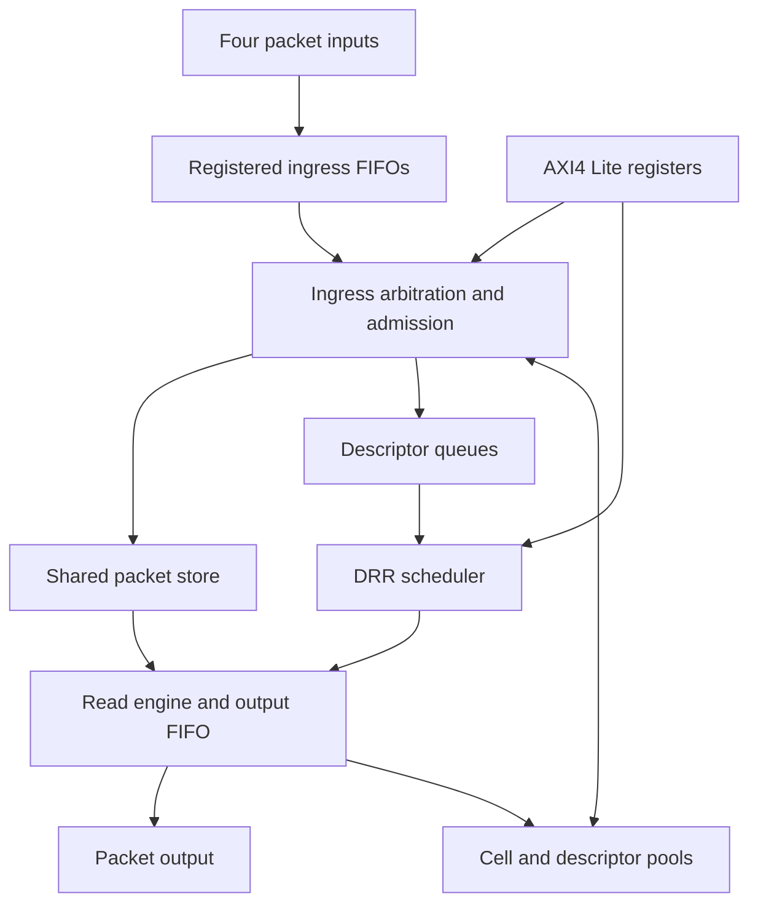

# Architecture and configuration

## Purpose

Implement a synthesizable, single-clock traffic-manager slice. Four independently backpressured packet inputs feed sixteen logical queues backed by a shared cell pool. A byte-aware scheduler selects complete packets for one output. The implementation includes packet admission, malformed-frame cleanup, descriptor queues, an AXI4-Lite control plane and observable statistics.

The release includes original SystemVerilog RTL, an exercised SV/UVM environment, assertions, independent packet/policy models, selected functional formal proofs, mapped synthesis and pre-layout timing, reusable components, automated regressions and a checked diagnostic-triage flow.

### Fixed scope decisions

| Decision | Contract and reason |
|---|---|
| Block granularity | One egress TM slice, not a four-output switch fabric. All input ports may send to every logical queue. This preserves sharing, concurrency and scheduling without claiming impossible bandwidth from one packet RAM. |
| Forwarding | Store and forward. An uncommitted or malformed packet is never scheduled. |
| Packet storage | Shared fixed-size cells, dynamically assigned to variable-length packets. Separate shared packet-descriptor pool. No fixed payload FIFO per queue. |
| Scheduling | Deficit round robin (DRR), with per-queue byte quanta. Packet RR is an elaboration-time comparison baseline. |
| Admission | Reserve the entire declared packet's cell budget and one descriptor before servicing its first payload beat. Resource congestion either rejects/drains or waits, according to a static global setting. |
| Memory bandwidth | At most one payload word write and one payload word read per core clock. Ingress and egress operate concurrently. Four inputs do not imply four writes per clock. |
| Clocking | One externally supplied core clock. No clock mux/divider, clock gating, CDC or DVFS completion requirement. |
| Reset | Common active-low reset, asynchronously asserted and synchronously released by the environment. Flush and reinitialize; preserve no in-flight packets across reset. |
| Configuration | AXI4-Lite slave; policy changes only while disabled and idle. No CPU or firmware platform is required. |
| Technology | Public reference standard-cell library for the implementation study. Record the exact library source, units and operating corner. |

### Exclusions

Ethernet parsing/classification, MAC/FCS generation or checking, MAC learning, L2/L3 forwarding, multicast, packet replication, cut-through, complete PFC/ECN, shaping/policing, hierarchical QoS, PCIe/RDMA, software drivers, FPGA bring-up, DFT insertion, physical implementation and silicon signoff are not required. Packet data are opaque bytes. Their external classification supplies the logical queue identifier.

These exclusions do not excuse missing shared allocation, finite-port memories, queue-update hazards, variable lengths, DRR, end-to-end packet checking, UVM, functional proofs or mapped timing analysis.

## Parameters and configurations

| Parameter | Default functional profile | Supported supported elaborations |
|---|---:|---|
| `DATA_W` | 64 bits | 64 only in version 1.0 |
| `N_RX` | 4 | 1, 2, 4 |
| `N_Q` | 16 | 2, 4, 8, 16 |
| `CELL_BYTES` | 64 | 16, 32, 64 |
| `N_CELL` | 1024 | Powers of two, 16 through 1024 |
| `N_DESC` | 256 | Powers of two, 8 through 256 |
| `MAX_PACKET_BYTES` | 1536 | 64 through 1536, also bounded by total payload capacity |
| `RX_FIFO_DEPTH` | 2 beats per input | 2 or 4; no fall-through required |
| `MEM_RD_LATENCY` | 1 cycle | 1 or 2, fixed for an elaboration |
| `TX_FIFO_DEPTH` | 4 beats | At least `MEM_RD_LATENCY+2`; test 4 and 8 |
| `SCHED_MODE` | DRR | DRR or packet RR; DRR is mandatory |
| `QUANTUM_DEFAULT` | `MAX_PACKET_BYTES` | Configurable per queue from 64 through 4096 bytes |
| `TRACE_ENABLE` | Verification enabled | Synthesis may remove verification-only tracing |

`WORD_BYTES=8`, `CELL_WORDS=CELL_BYTES/8`, `N_WORD=N_CELL*CELL_WORDS`. A packet of declared length `L` reserves `ceil(L/CELL_BYTES)` cells. Storage fragmentation is counted in cells; scheduling and transmitted-byte statistics use actual packet bytes.

Elaboration MUST reject unsupported values, `MAX_PACKET_BYTES>N_CELL*CELL_BYTES`, insufficient counter/index widths, invalid FIFO depth, and a deficit width smaller than needed for `4096+MAX_PACKET_BYTES-1`. Use guarded widths such as `max(1,clog2(N))`; do not rely on zero-width vectors.

### Required parameter matrix

| Profile | RX / queues | Cells × cell bytes | Descriptors | Maximum packet | Read latency | Purpose |
|---|---|---|---:|---:|---:|---|
| F0 | 4 / 16 | 1024 × 64 | 256 | 1536 | 1 | Main functional and traffic experiments |
| F1 | 4 / 16 | 1024 × 64 | 256 | 1536 | 2 | Latency/credit robustness |
| I0 | 2 / 4 | 32 × 16 | 16 | 256 | 1 | Fully mapped small implementation baseline, 512-byte packet store |
| I1 | 2 / 4 | 32 × 16 | 16 | 256 | 2 | Comparable pipeline/banking experiment |
| E0 | 1 / 2 | 16 × 16 | 8 | 128 | 1 | Small endpoint and resource-boundary regression |
| E1 | 4 / 8 | 64 × 32 | 32 | 512 | 2 | Intermediate configuration |

Formal kernels may use fewer cells/descriptors than the production range. Their reduced scope MUST be reported, rather than presented as a full-size parameter proof. Increasing these configuration counts later is an extension, not an obligation to support arbitrary values.

## Architecture

Recommended module boundaries are `tm_top`, `tm_axis_rx_fifo`, `tm_rx_arb`, `tm_admission`, `tm_cell_pool`, `tm_desc_pool`, `tm_packet_ram`, `tm_queue_ctrl`, `tm_drr`, `tm_tx`, `tm_abort_reclaim` and `tm_axil_regs`. Boundaries may be combined when they add no useful separation. Cell/descriptor pool logic, queue control, elastic FIFOs, register interfaces and DRR state are useful reuse candidates.

No claim of reuse is earned merely by adding parameters. At least two supported configurations or meaningful instances of the chosen reusable components MUST be exercised.

## Performance and implementation experiments

### Capacity and bandwidth

At 64 bits, one read and one write per cycle permit at most eight useful bytes per cycle in each direction before partial-beat inefficiency. At an illustrative 100-MHz clock this ceiling is 6.4 Gbit/s per direction for the slice, not 6.4 Gbit/s per input. Do not call it Ethernet wire rate; headers, FCS and interpacket gaps are outside the block.

The default functional profile has 64 KiB of payload cells. It does not have 64 KiB of useful capacity for one-byte packets: each packet consumes a whole cell and a descriptor. Report both cell occupancy and useful bytes. Queue caps and descriptor exhaustion can limit admission before the payload pool is full.

### Mandatory comparisons

1. **Shared versus fixed partitions:** equal total payload capacity and descriptor budget, same traffic and service. Exercise a hot-queue burst, uniform bursts and multiple active queues. Report admissions, drops, useful bytes and occupancy. The fixed-partition reference can be an admission-policy model, provided it is clearly not claimed as a separately synthesized RTL design.
2. **DRR versus packet RR:** identical packet sources and output behavior; mixed 64-byte/1536-byte packets; equal and unequal quanta. Measure bytes, packets, fairness and latency. Equal packet counts are not a byte-fairness baseline.
3. **Memory/pipeline trade-off:** at least two synthesized variants or supported implementation configurations, matched function and capacity where possible. Report their effect on the traffic manager's area, timing, latency and throughput with the analysis boundary stated.
4. **Backpressure and contention:** source gaps, all inputs active, DROP/WAIT modes, full pools, descriptor exhaustion, and ready patterns containing long stalls followed by release.

Measure input capture-to-output completion latency and commit-to-first-output latency separately. Include p50/p95/p99 and maximum for finite experiments. State warm-up, sample count, offered/admitted/delivered traffic, clock period, read latency and configuration. Do not omit dropped packets when describing offered-load behavior.

### Targets and reporting limits

The version-1 traffic target for F0/F1 is at least 0.85 output beats/cycle for saturated 1536-byte packets, default quanta, no sink stalls, after warm-up. Minimum-packet performance MUST be measured and its control/scheduling overhead explained; version 1 does not promise one completed packet per cycle. Failure to meet a target triggers a bottleneck investigation and an explicit specification revision if necessary, not concealed changes to workload or accounting.

For I0/I1, start with a 10-ns pre-layout timing target, 2-ns external input/output delays, 0.10-ns clock uncertainty and explicit slew/load assumptions. State both min/max external delay assumptions and inspect setup/max and hold/min reports; a one-corner ideal-clock hold check is not post-CTS hold closure. These are analysis conditions, not silicon guarantees. Use a cell library with recorded source, hash, PVT and units. Report worst slack and all intended constrained path groups. No routed parasitics, placement area, clock-tree closure, signoff or measured power is claimed by this project.

If a large configuration abstracts SRAM, report control/metadata area separately, storage bits and macro assumptions. Never compare a black-box memory variant with a flop-mapped variant as if both included equal total hardware.
